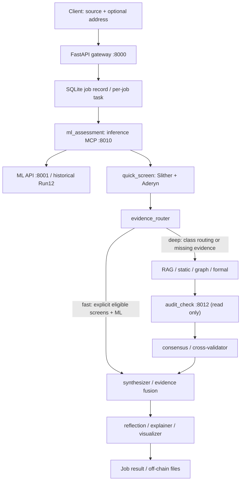

# S4-01-001 — Executable architecture, product scope and trust map

**Source baseline:** 9eaaae171c09650f6cca6eae3f4b56c7965cf050 (2026-11-26)
**Status:** source-traced first slice; bounded corrections validated; G01 remains in progress.

[Master program](../00_MASTER_PROGRAM.md) | [Audit protocol](../01_AUDIT_PROTOCOL.md) | [Current status](../CURRENT_STATUS.md) | [Evidence](../evidence/2026-11-26_s4_01_001/WORKING_RECORD.md)

This map reassesses the architecture, not merely redraws the handbook. Source symbols below refer to the inspected baseline unless explicitly marked as the repair delta. Existing bounded test evidence comes from S4-00, plus this slice's synthetic AGENTS regressions. No live ML, LLM, RPC, proof generation, deployment, actual user study or independent benchmark was performed.

## 1. Accepted target direction (S4-D-0001)

Sentinel's primary product is an **evidence-first, off-chain smart-contract security investigation system**, aimed initially at a local technical analyst or researcher investigating Solidity. Its report should communicate actionable source-grounded findings, conflicting evidence, tool coverage, limitations and next investigative steps, not promise a comprehensive or certified audit.

Keep three separately governed tracks:

1. Investigation runtime: deterministic tool adapters and evidence/provenance contracts own observations; orchestrator coordinates bounded investigation; LLMs assist contextual interpretation and explanation, but cannot independently establish tool execution or authorization.
2. DATA/ML research: scientific dataset lineage, representation experiments, bounded model/evaluation work. Current Run12 is a historical operational dependency, not a validated repaired teacher. Preserve R4; improve future ML usefulness only with appropriate evidence.
3. Optional trust/verification research: retained proxy computation proof and context attestation, versioned registry/history, separate isolated signing authority. No mandatory proof/chain dependency for useful off-chain reporting.

Decision rationale: the current three tracks already have independent executable entry points and materially different trust claims. Requiring a successful model training program, proof generation or on-chain action for every investigation unnecessarily couples value delivery to unavailable assurance. Conversely, deleting those modules would discard research, learning and reproducibility value without comparative evidence. Retain all implementations for now; separate the product path, gate optional capabilities and compare incremental utility before architectural replacement.

Alternatives considered: keep all components mandatory (reject: mismatched trust and availability boundaries); rewrite as LLM-only auditor (reject: cannot establish execution provenance or comparable scientific evidence); retire ML/ZK now (reject: no utility comparison and protected historical work); retain modular research tracks with off-chain core (accepted as direction, not release certification). No dependency, taxonomy, objective, artifact promotion, model or cryptographic protocol is selected by this decision. Rollback: revise S4-D-0001 with measured results; no destructive migration.

User on 2026-11-26 delegated architecture/design decisions and routine implementation. Consequential work may proceed without repeated approval, subject to evidence and existing safety constraints. No real deployment/funds/credentials, irreversible actions, external private data transfer or bypass of domain acceptance.

## 2. Executable investigation runtime

Arrows describe source control flow, not currently running services. ML MCP calls ML API and returns to the orchestration node; diagram omits that return arrow. Deep fan-out varies by class/availability and joins through audit_check. No proof, signing or broadcast is a normal gateway completion step.

| Seam / producer | Actual source anchor | Contract, state owner, failure boundary |
|---|---|---|
| HTTP admission | agents/src/api/gateway.py: create_app, submit_audit, get_audit, list_audits; api/models.py: AuditRequest | Source code, optional address, timeout, metadata; auth/tenant controls and 202 job ID. Derived address when omitted is not verified deployed contract identity. |
| Job lifecycle | api/gateway.py: _run_job; api/sqlite_job_store.py: SqliteJobStore.create/mark_running/mark_completed/recover_pending | SQLite job and report; task timeout/exception -> FAILED; default restart converts pending to failed rather than resuming graph. Default graph factory uses use_checkpointer=False. Optional SqliteSaver/MemorySaver exists but not default gateway recovery. |
| ML producer | ml/src/inference/api.py: lifespan/predict/hotspots/fusion_embedding; predictor.py: Predictor; ml/mlops_config.json | Historical Run12 checkpoint, versioned representation compatibility, ten class probabilities/tiers/hotspots/fusion. Service identity and thresholds are not calibrated repaired-model evidence. Availability checked separately. |
| ML evidence consumer | orchestration/nodes/ml_assessment.py: ml_assessment; orchestration/provenance.py: eligible_ml_result; contracts/execution.py | MCP predict output must pass execution status and input/output binding; invalid/unavailable is structured and cannot be admitted as live ML evidence. Provenance is not correctness of predictions. |
| Initial screening | orchestration/nodes/quick_screen.py: quick_screen; nodes/_helpers.py: _run_aderyn_on_file | Local Slither and Aderyn; detector subset, hit lists and tool_status. Failed tool may return empty hits with ran=False; empty is not successful evidence. |
| Branch selection | orchestration/graph.py: build_graph; orchestration/routing.py; nodes/evidence_router.py | 14 nodes. Pre-repair edge used threshold-selected tools and empty hits but ignored tool execution status. Repair centralizes branch/trace and requires explicit successful empty screens for fast path. |
| Investigation tools | nodes/static_analysis.py; nodes/rag_research.py; nodes/graph_explain.py; nodes/formal_verification.py; nodes/audit_check.py | Static tool observations, contextual retrieval, hotspots/representation, symbolic claims, registry reads. Tool status/capability must delimit meaning. Generic Halmos harness assumes Target/deposit/withdraw; applicability to arbitrary contracts not established. |
| Aggregation | nodes/consensus_engine.py; nodes/cross_validator.py; verdict/emit.py; verdict/fuse.py | Consensus emits ML/static/derived vote evidence; LLM debate may emit evidence; fusion groups families and produces deterministic-only and full verdict tiers. Need audit of derived evidence dependence and coverage; deterministic-only is NOT ZK-proven. |
| Human report | nodes/synthesizer.py, reflection.py, explainer.py, visualizer.py; persistence/report_writer.py | Final report and enrichment; job-scoped atomic report and HTML outputs. Synthesis happens before reflection/explainer/visualizer; check persisted vs returned completeness and failed write semantics in S4-05/07. Overall label from ML, verdict from fusion; neither alone certifies security. |
| Job response | gateway._run_job -> store.mark_completed | Gateway normalizes submission and stores report plus selected graph outputs. COMPLETED is job lifecycle, not successful security assessment or finality. |
| LLM client | agents/src/llm/client.py; three node gates in nodes/_helpers.py, cross_validator, synthesizer, reflection | Local OpenAI-compatible configuration; job no_llm previously metadata-only and global gateway patch affected module state. Repair passes typed job flag; process-wide disable still dominates. LLM output cannot replace deterministic provenance. |

Relevant configuration: runtime_default.yaml, verdicts_default.yaml, reliability versions, ML config, service environment. Exact endpoint compatibility, dependency admission and tool versions remain S4-02/05 work. RAG index built by ingestion/pipeline.py IngestionPipeline and consumed by rag/retriever.py using FAISS/BM25/chunks; index publication, serialization trust and context-vs-evidence are open audit areas. MCP port map follows current handbook/runtime: inference 8010, RAG 8011, audit read-only 8012, graph 8013, representation 8014. Do not assume each MCP is invoked in every run.

## 3. Scientific and proof paths

| Track / seam | Source or governing identity | Status and boundary |
|---|---|---|
| DATA acquisition/preparation | data_module/sentinel_data/cli.py: _run_ingest/_run_preprocess/_run_represent/_run_label/_run_split/_run_export | Mixed historical lifecycle and active source utilities; distinguish historical artifacts from R4 authority. |
| Logical V3 | vnext/r4_logical_v3.py: build_logical_v3_publication/bind_logical_v3_publication; vnext/policy.py: semantic_decision/effective_loss_mask | D-009 logical grouping/roles and label masks. Unknown is not negative; independent evidence required. |
| Physical graph/token | vnext/r4_v10_binding.py and representation modules; D-011 and D-013 acceptance | Exact immutable roots; 22,540 identities; accepted tokens [4,512]. No in-place regeneration. |
| ML research | ml/src/training/vnext_guarded_runner.py: run_guarded_phase8_bounded; vnext_guarded_run_control.py; vnext_losses.py: masked_bce_positive_loss/positive_selection_metrics | D-014 bounded control; D-015 M4 complete, full-training false. Positive-fit diagnostic not discrimination; D-016 class semantics and GAP-007 separate independent review. |
| Teacher/runtime selection | ml/mlops_config.json; Predictor; ML completion/promotion roadmap | Run12 still default operational identity, no automatic R4 handoff. |
| Teacher -> proxy | ml/src/inference/predictor.py: predict_fusion_embedding; zkml/src/distillation; zkml/src/ezkl/run_proof.py: extract_contract_features/generate_proof | Historical teacher fusion[128]; proxy 128->64->32->10; legacy_proxy_only_unbound. Not proof of teacher execution or source correctness. |
| Circuit and artifacts | zkml/src/ezkl/setup_circuit.py: validate_lineage/run_pipeline; validate_bundle.py | ONNX/settings/circuit/SRS/keys and manifests; retained UNSAFE mode limitation; setup/proof generation not exercised. |
| Policy attestation | agents/src/security/policy_signer.py: build_v3_request/compute_v3_digest/evaluate_v3_request | Context-bound request and eligibility, separate configured signer authority; no production signer service claimed. |
| On-chain | contracts/src/AuditRegistry.sol: initializeV3, submitAuditV3, _authorizeAndVerifyV3, _storeV3Result; generated ZKMLVerifier.sol; SentinelToken | V3 proof + request attestation, authorization, replay checks, UUPS compatibility; V1/V2 history. No live transactions. |
| Readback | agents/src/mcp/servers/audit/_readonly_handlers.py: list_tools/call_tool, get_latest/get_history/check_exists | Exactly three version-aware read tools; no submit/sign. Prior audits are history, not vulnerability truth for the submitted source. |

## 4. Capability and usefulness matrix (hypotheses, not empirical rankings)

| Capability | Present implementation / evidence | Intended user value | Required utility or correctness evidence |
|---|---|---|---|
| Static screening | Source + selected archive/route boundary tests; real tool capability not validated here | Rapid source-specific finding triage | Compile coverage, detector findings with source locations, explicit failure and cost; deterministic baseline. |
| ML scores/hotspots | Source + historical local artifact presence; synthetic Phase-8 tests | Prioritize hard cases, additional signal beyond analyzers | Held-out eligible examples, incremental evidence-qualified findings and false alarms, latency, calibrated interpretation only if supported. |
| Graph/representation | Source adapters | Explain program flow and localize code | Real contract graph fidelity, useful references, version compatibility. |
| RAG | Source/index presence | Retrieve relevant prior patterns and mitigation context | Relevance and attribution, context-only vs direct evidence, poisoning/failure cases; no hallucinated citations. |
| Formal tool | Source, generic harness assumption | Prove/refute explicit properties with scope | Applicability checks, exact property and target identity, counterexamples, timeout/unknown; no generic proof claim. |
| LLM debate/narrative/reflection | Source and controlled no-LLM regressions | Explain findings, surface contradictions and next steps | Evidence grounding, abstention, unsupported claim rate, usefulness against deterministic report and single-pass alternative. |
| Fusion/report | Source + synthetic gateway/routing tests | Combine observations without duplicate evidence, convey uncertainty | Coverage-aware verdicts, dependency families, evidence IDs, truthful report under degraded paths. |
| Durable execution | SQLite jobs and optional graph checkpointer source | Recoverable audit history, bounded jobs | Crash/retry/cancel/concurrency and publication semantics; current gateway restart fails pending jobs. |
| DATA/ML research | Accepted lineage and bounded pilot records | Reproducible research and future useful teacher | R4 evidence/gates; no full run authorization. |
| Proof/registry | Source and bounded local contract/bundle tests | Optional reproducible proxy result / context record | Proof scope, safe assurance, exact parity and policy authority; usefulness relative to signed/off-chain evidence manifest. |

No current evidence supports a comprehensive accuracy, security certification, production-readiness, or on-chain trust guarantee for the whole system.

## 5. Immediate discoveries and decisions

F-0011: per-job no_llm control was not enforced; all three node LLM gates read process flags only. F-0012: failed/missing screens could qualify fast path, and path_taken was inferred from nonempty results rather than executed branch. Both reproduced with synthetic regression tests and repaired in this slice. See working record and test evidence. The report-level adequacy problem is separate: an empty verdict map yields overall SAFE (routing.compute_overall_verdict), observed during a failed mocked flow even when overall_label unknown and manual-review recommendation present. F-0013 requires immediate coverage-aware output policy and consumer migration assessment; do not equate the routing fix with solving this. F-0014: deterministic-only verdict_provable is described as ZK-anchorable in AGENTS docs/comments but retained circuit verifies proxy only; this is a source-confirmed assurance-claim mismatch, not a new proof defect. Correct current claims under S4-06/08 and retain compatibility key until justified versioned design. F-0015: normal gateway uses checkpointer=False, restart fails jobs; evaluate desired durable workspace/recovery requirements rather than call it a defect without product criteria.

## 6. Comparative utility plan — S4-01-002/003

First repair report adequacy (F-0013) and align claims; then define a bounded analyst task corpus separate from R4 metric roles. Use legal/public synthetic/known cases with manually established source-level questions and expected evidence, include no-result, compilation failure, unsupported property, missing tool, contradictory observations and prompt-injection cases. Freeze inputs and evaluation rubric before comparing. Do not use R4 untouched acceptance or fabricate negatives; evaluate report-level observations and abstention, not model discrimination absent eligible data.

Compare incremental variants under equal input/budgets: deterministic analyzer and structured report; add ML (historical clearly marked), add evidence retrieval, add bounded LLM explanation/debate, add formal property where applicable. Optional proxy/attestation compared separately with hash-bound evidence manifest/signed attestations, not as accuracy enhancement. Record source correctness, actionable findings, unsupported claims, missed task-relevant evidence, tool coverage, abstention, latency, resource use and analyst review burden. Measure case-level results, preserve adverse/inconclusive results, no arbitrary numeric threshold. A small pilot establishes feasibility, not population generalization. Select architecture only after useful comparison; no model training or proof production needed for first benchmark design.

S4-G01 remains IN_PROGRESS: source map, target direction and initial repairs complete; user/task acceptance, coverage policy and bounded comparative design/evidence remain required. S4-02 may proceed in parallel; dependency drift remains an explicit constraint. Next slice S4-01-002: evidence adequacy and report truthfulness before utility experiments.

## 7. S4-01-003A controlled utility pilot

[Predeclared case manifest](../evidence/2026-11-26_s4_01_003/utility_cases.json), [raw evidence](../evidence/2026-11-26_s4_01_003/utility_results.json). Actual Slither 0.11.5 + cached solc 0.8.22, selected timestamp detector only, three newly authored synthetic inputs, offline scratch and current synthesizer. Compare scoped analyzer observation, actual direct report, direct report with synthetic unrelated RAG evidence, historical raw fusion comparator. No actual RAG retrieval/ML/LLM/other detector/full graph execution. No vulnerability truth labels, no negative accuracy claims.

| Case | Tool state | Observed | Report | With unrelated context |
|---|---|---|---|---|
| timestamp-01 | COMPLETED | timestamp detector, lines 3-6 include expected line 4 | WATCH | WATCH |
| arithmetic-01 | COMPLETED | no timestamp finding | INCONCLUSIVE | INCONCLUSIVE |
| compile-01 | FAILED | compiler rejected malformed input | INCONCLUSIVE | INCONCLUSIVE |

All five predeclared checks per case pass (15/15, some direct-finding checks are conditional and vacuous for no-hit cases). Historical raw fusion with synthetic context yielded CONFIRMED in all three cases; current projection does not promote unrelated Reentrancy context. This is an observed controlled counterexample to contextual-only promotion, not a population-level comparison. The WATCH band is a weak signal requiring review, not a confirmed vulnerability. The current report honestly abstains on successful limited scan when ML and Aderyn unavailable, but lacks a dedicated scoped static-only completion result; evaluate whether additional explicit coverage dimensions improve practical usability rather than weakening the policy. Existing report coverage is conservative. No user usefulness or accuracy established.

S4-01-003B: build task-scoped coverage-aware evaluator, use real tool adapters/full graph under explicit isolated budget with known source cases, compare actual deterministic report baseline vs optional ML/RAG/LLM independently; measure useful source-grounded observations, unsupported claims, abstention, coverage, cost. Historical raw fusion comparator not a shipped legacy full pipeline. G01 remains in progress.
